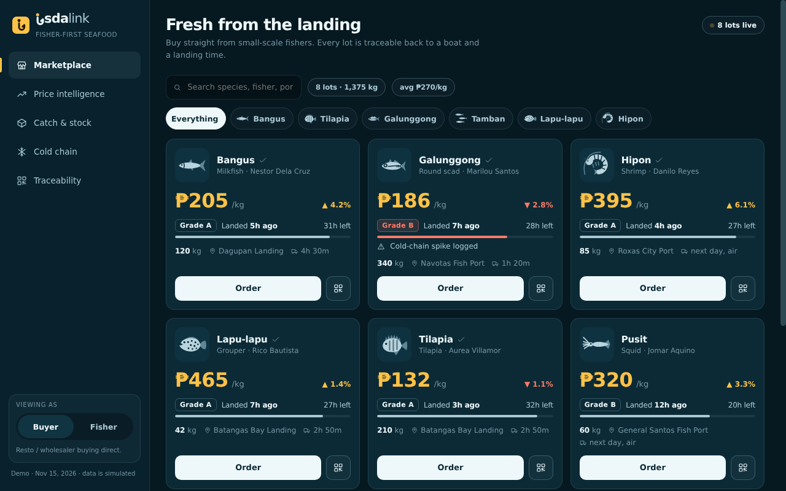

# IsdaLink

A fisher-first seafood marketplace for the Philippines — **React demo**.

Small-scale fishers lose money twice: to middlemen who set the price, and to spoilage between the boat and the buyer. IsdaLink is a single platform that fixes both — a marketplace where a fisher posts today's catch directly, an AI price forecast that says *sell now or hold*, cold-chain partners booked in one screen, and a QR code on every lot so a restaurant can see which boat landed it and how cold it stayed.

**Live demo:** https://islalink-hub6.vercel.app



---

## What's in the demo

Five product pillars, five working screens. Everything is clickable — no dead buttons, no mockups.

| Pillar | Screen | What actually works |
| --- | --- | --- |
| Fishery marketplace | **Marketplace** | Filter and search live lots, place an order with quantity + cold-chain delivery, see the total (catch + logistics + 3% fee). As a fisher: post a catch and watch it appear on the market. |
| AI price prediction | **Price intelligence** | Pick any of 9 species, get a 14-day price history plus a 7-day forecast with a widening confidence band, a hold/sell verdict with a reason, and the drivers behind it weighted. |
| Catch & inventory management | **Catch & stock** | Live catch log with spoilage risk per lot (hours on ice vs shelf life), week's earnings and loss figures, and ranked "act now" alerts. |
| Cold chain & delivery | **Cold chain** | Choose ice supplier, cold storage and courier; the booking total recalculates live against the cost of dumping a spoiled lot. |
| QR seafood traceability | **Traceability** | Every lot has a lot ID, QR label, full handling record (boat → ice → cold room → truck → buyer), cold-chain temperature range, and independent buyer checks. |

### Two roles, two interfaces

The role toggle (sidebar on desktop, top bar on phone) switches between two genuinely different products, not one screen with different words:

- **Buyer** — a restaurant or wholesaler. Dark, dense, built for comparison. Price, freshness grade and delivery ETA per lot.
- **Fisher** — Nestor, a small-scale fisher in Dagupan. A **daylight theme** for reading in glare at the landing, larger numerals (price and volume), one primary action per card, plainer language, and the buyer's orders first.

`.app.fisher` in `src/styles.css` carries the whole second theme.

### A five-minute path through it

1. **Marketplace** → tap **Order** on Bangus → drag the quantity → **Place order**. Watch the stock drop, the toast confirm, and the order appear with its lot ID.
2. Toggle to **Fisher** → **Post catch** → 60 kg at ₱210 → it lands on the marketplace instantly.
3. **Price intelligence** → switch species → read the verdict. *Bangus* and *Hipon* give different calls because the verdict is computed, not canned.
4. **Cold chain** → move the ice slider and watch the total beat the cost of a spoiled lot.
5. **Traceability** → open a lot → the record shows scheduled events dimmed. One lot carries a cold-chain breach so the audit checks aren't all green.

---

## How it's built

React 18 + Vite, **zero UI dependencies** — no chart library, no icon pack, no CSS framework. Every visual is hand-rolled: the price chart, the sparklines, the QR matrix, the 9 species illustrations and the 40-odd icons are inline SVG.

```
src/
  main.jsx              React root
  App.jsx               shell, navigation, role state, order + lot wiring
  styles.css            design tokens + both themes (single source of truth)
  views/                one file per screen
    Market.jsx          marketplace + order sheet + post-catch sheet + order inbox
    Prices.jsx          forecast, verdict, drivers, demand heat, market pulse
    Inventory.jsx       catch log, spoilage risk, weekly numbers
    Logistics.jsx       ice / cold storage / courier booking and cost maths
    Trace.jsx           lot QR, handling record, freshness, buyer audit
  components/
    Chart.jsx           PriceChart (history + forecast band) and Spark
    SpeciesArt.jsx      9 inline-SVG species silhouettes
    Brand.jsx           hook-i mark and wordmark
    QrCode.jsx          renders a QR matrix as a CSS grid
    Icons.jsx           inline SVG icon set
    ui.jsx              Card, CardHead, Stat, Pill, Bar, Tag, Chips, Empty
  lib/
    forecast.js         price engine (deterministic)
    trace.js            lot + QR + handling record generator (deterministic)
    format.js           pesos, kg, PHT dates, the fixed demo clock
  data/
    market.js           seeded demo data: listings, orders, ports, partners
```

### Run it

```bash
npm install
npm run dev      # http://localhost:4180
npm run build    # production bundle in dist/
npm run preview  # serve the build on :4180
```

`vite.config.js` pins port 4180 and allows tunnel hosts, so the build can be shared through Cloudflare or served on Vercel without further config.

---

## The data is simulated — and deterministic

There is no backend, no database and no auth. That is a deliberate choice for a demo, and it has one useful property: **every number is reproducible.** Both engines use a seeded PRNG (mulberry32 over an FNV-1a hash of the inputs), never `Math.random()` or `Date.now()`.

- The clock is fixed at **2026-11-15, 09:35 PHT** (`NOW` / `TODAY` in `src/lib/format.js`), a Sunday.
- `getForecast('galunggong', { today: '2026-11-15' })` returns the same 14 history points and 7 forecast points on every device, forever.
- The same lot ID always produces the same QR matrix, the same 7 handling events and the same cold-chain readings.

Time-dependent behaviour takes `now` as an argument instead of reading the clock, which is also what makes the screens testable.

Prices are realistic 2026 wet-market pesos: galunggong ~₱180/kg, lapu-lapu ~₱420, hipon ~₱380.

### What is *not* real

- **Prices are simulated**, not market data. The real thing needs the pipeline in [`docs/forecast-pipeline.md`](docs/forecast-pipeline.md).
- **The QR is decorative.** It's a deterministic matrix, not a scannable payload — it renders the idea, not a working code.
- **Nothing persists.** Refresh and you're back to the seeded state.
- **No tests.** There is no test runner in this repo. Every flow was verified by driving the real build in a headless browser, and those captures live in `docs/creative/`.

---

## Design decisions

- **The fisher is the first letter.** The "i" in IsdaLink is a fishhook, its dot the eye where the line ties on.
- **Amber means one thing: what the fisher earns.** Prices, totals, the Sell button. Alerts get coral. Everything else is neutral. Two accent hues, not four.
- **Freshness is derived, never decorative.** Cards show `Grade A · Landed 5h ago · 31h left` from the lot record. An earlier version printed a "FRESH" badge on six-hour-old fish — that badge is gone.
- **Filipino name first.** Cards read *Bangus*, not *Milkfish*, because that's what the person selling it says.
- **Fisher targets ≥44×44px.** Measured on a 390px viewport: 29 interactive elements, zero under 44px, price and quantity numerals at 20px or more.

---

## Documentation

| File | What it covers |
| --- | --- |
| [`docs/app-documentation.md`](docs/app-documentation.md) | Screen-by-screen reference, component APIs, data shapes, state model |
| [`docs/system-architecture.md`](docs/system-architecture.md) | The real system: services, sync model, offline-first, SMS channel |
| [`docs/domain-model.md`](docs/domain-model.md) | Entities and relationships for the production product |
| [`docs/schema.sql`](docs/schema.sql) | Postgres DDL — 36 tables, append-only trace events |
| [`docs/forecast-pipeline.md`](docs/forecast-pipeline.md) | How the price model becomes real: labels, features, evaluation, guardrails |
| [`docs/mvp-scoping.md`](docs/mvp-scoping.md) | 90-day pilot, one coop in Dagupan, costs and metrics |
| [`docs/risks-and-compliance.md`](docs/risks-and-compliance.md) | Data Privacy Act, BFAR/LGU, cold-chain liability, buyer bypass |
| [`docs/OWNER-DECISIONS.md`](docs/OWNER-DECISIONS.md) | Decisions that override anything above (e.g. Neon, not Supabase) |

---

## Deployment

Deployed on Vercel from `master`. Vite is auto-detected: build `npm run build`, output `dist/`.

> **Deployment protection is on.** `islalink-hub6.vercel.app` currently answers with Vercel Authentication rather than the app. Turn it off in the project's **Settings → Deployment Protection** to make the URL public.
