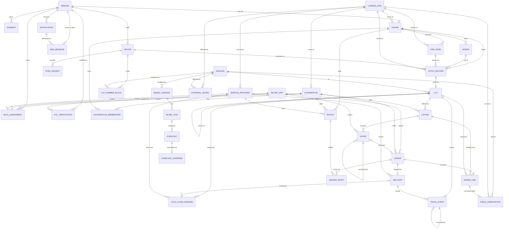

# IsdaLink — Domain model

This explains every table in `schema.sql`: what it is, and why it is shaped the way it is.
The two files cover the same 36 tables plus one view (`lot_stock`). If you add a table to one, add it to the other.

Words used below:
- **Entity**: a thing the system keeps records about (a fisher, a lot, an order).
- **Invariant**: a rule that must always be true, e.g. "you cannot sell more kilos than you have".
- **Append-only**: rows are only ever added. Nobody edits or deletes them. Mistakes are fixed by adding a correction row.
- **Seller of record**: the party whose name is on the receipt and who is legally selling the fish.

## The five ideas everything else hangs on

1. **The lot is the unit of truth.** A lot is one weighed batch of one species from one catch, with one QR code. Listings, order lines, temperature readings and trace events all point at a lot. The demo already works this way (`makeLot`, `lotId` on every listing), so the real system keeps it.
2. **The cooperative is the seller of record, not the fisher.** Small fishers rarely have a BIR registration, a business permit or a way to issue receipts. Cooperatives have all three. Selling through the coop also makes the coop an ally: it gets a share of the fee, and buyers who skip IsdaLink also skip the coop's receipts and traceability (see risks-and-compliance.md).
3. **Facts are never edited.** Catches, trace events, temperature readings, price observations and ledger entries are only ever added. This is what makes a traceability claim worth trusting, and it is also what makes offline sync simple: two devices adding facts never conflict.
4. **Stock is calculated, not stored.** Stock on hand is weighed kilos minus sold kilos minus recorded losses (`lot_stock` view). A stored "stock" number would drift from reality the first time a sync arrives late.
5. **Money is a double-entry ledger.** Every peso movement is written as at least two rows that add up to zero (money leaves one account and enters another). Balances are sums. This is the only way to answer "how much do we owe Nestor?" without guessing.

## Entity relationship diagram

Relationships only. Columns and types are in `schema.sql`.

`JOB` has no relationships (it is a work queue) so it is not drawn.

## People and access

### person
One human, whatever they do. Login identity is a Philippine mobile number (`+639…`), checked with a one-time SMS code. **Why:** almost every fisher has a phone number; few have email.
- `low_literacy_mode` and `feature_phone_only` live on the person, not on a role, because they describe the human. They switch the UI to icon-and-voice mode or route everything through SMS.
- Soft delete (`deleted_at`) closes an account. `erased_at` is for a Data Privacy Act erasure request: name and phone are blanked, but the row stays so old lots and ledger entries still point at something. **Trade-off:** we keep a "ghost" row forever, in exchange for never breaking the traceability chain.

### role_assignment
What a person is allowed to do, and for which organisation: `fisher`, `buyer_staff` (for a buyer org), `coop_encoder` and `coop_manager` (for a cooperative), `provider_staff` (for an ice plant, cold room or courier), `admin`. **Why a separate table:** one person is often several things; a coop manager is usually also a fisher. The `role_scope` check makes sure a coop role always names a coop, a buyer role always names a buyer org, and so on.

### consent
One row per purpose a person agreed to (account, showing their name on public trace pages, daily price SMS, use in anonymised analytics, marketing), with the wording version and how it was given (app, SMS reply, paper form at the desk). **Why:** the Data Privacy Act needs proof of consent per purpose, and a fisher may say yes to price SMS but no to their name on QR pages.

### kyc_verification
"Know your customer" check: a photo of a document plus a reviewer's decision. It applies to a person (FishR ID, BoatR certificate, pond permit, PhilSys ID) or a buyer org (business permit, DTI/SEC registration, BIR 2303). **Why a separate, many-row table:** documents expire and get re-checked; the history matters. The demo's `verified: true` on a listing becomes a derived fact: approved KYC for the fisher, plus BoatR/permit for the vessel or farm. Photos go to a private storage bucket; only the path is stored.

### cooperative
A registered fisherfolk or growers' cooperative (CDA registration number). It is the seller of record. `fee_share_pct` is the part of IsdaLink's fee that goes back to the coop. **Why:** this money is what makes the coop push its members onto the platform instead of around it.

### cooperative_membership
Which fisher belongs to which coop, with join and leave dates. A partial unique index allows only one active membership per fisher. **Why one:** the seller of record for a lot must be unambiguous.

### buyer_org
Restaurant, wholesaler, public-market stall, retailer, institution (school, hospital) or individual consumer. Staff log in as persons with `buyer_staff` roles. `credit_limit_php` is 0 for everyone in Phase 0 (pay first); it exists because B2B buyers will ask for 7-day terms. `tin` is needed for official receipts.

### service_provider
Ice plants, cold storage rooms and couriers in one table, split by `kind`. **Why one table:** in Phase 0 they all behave the same way (a name, a site, a phone, a quote, gets paid). The demo's `ICE_SUPPLIERS`, `COLD_STORES` and `COURIERS` map straight in. `price_note` is free text on purpose; prices are phoned in by the desk until there is a real delivery marketplace.

## Places, species, producers

### landing_site
A fish port, a municipal landing, or a cluster of ponds. The id is a short slug matching the demo's `PORTS` ids (`navotas`, `dagupan`, `batangas`, `roxas`, `gensan`). **Why a slug and not a uuid:** it shows up in forecasts, SMS text and URLs, and it is the "port" in the price label (species × port × day).

### species
The species catalogue. `id` matches the demo `SPECIES` ids (`bangus`, `tilapia`, `galunggong`, `tamban`, `lapulapu`, `hipon`, `alimasag`, `pusit`, `tahong`). `schema.sql` seeds all nine, plus the five demo ports in `landing_site`. `code` is the 3-letter segment in the lot id. `reference_size_class` is the one size every price is converted to before it trains the model. `forecastable` turns on only when there is enough data (see forecast-pipeline.md). `shelf_life_hours_on_ice` sets default listing expiry and freshness warnings.

### fisher
Extra facts for a person who catches or farms fish: capture or aquaculture, BFAR FishR number, home landing site, GCash number for payouts. Its primary key *is* the person id. **Why:** a fisher is a person with extra fields, not a separate human.

### vessel
A boat (`F/B Sta. Clara 3`). BFAR BoatR number, gross tonnage, class. `municipal` means 3 gross tonnes or less, fishing in municipal waters, which is the core user. Owned by a fisher. Soft-deletable because boats get sold or wrecked, but old lots must still point at them.

### fish_farm
A pond, cage, pen or mussel raft. The demo has one ("Pond harvest · Brgy. Sta. Maria"). Holds the FLA or LGU permit number, area, barangay and nearest landing site. **Why separate from vessel:** a harvest has a fixed location and a planned date. That is a stronger traceability story and an easier forecasting problem, which is why the pilot starts with pond bangus.

## Offline sync plumbing

### device
A phone or tablet running the app. The app creates the id on first install. **Why stored:** a lost or stolen desk tablet can be revoked, and its pushes are then refused.

### lot_number_block
A reserved run of 50 lot numbers for one week and one species, given to one device. Block `k` owns numbers `k×50+1` to `k×50+50`. **Why:** the coop desk must print the final QR sticker the moment fish is weighed, even with no signal. With pre-reserved numbers, two offline tablets can never print the same lot id. A unique constraint on (week, species, block) is all the database needs to guarantee that.

### sync_receipt
A log of every offline operation the server has handled, keyed by (device, client operation id). **Why:** phones on bad signal resend things. If the same "record catch" arrives twice, the server finds the receipt and returns the stored answer instead of making a second catch. Programmers call this *idempotency*: doing it twice has the same effect as doing it once.

## Catch, lots, inventory

### catch_record
One landing from one boat trip, or one pond harvest: who, which boat or farm, which landing site, when it landed, who entered it (usually the coop encoder at the desk), which device, the device time and the server time. It holds no weights; weights belong to lots. **Why:** one trip produces several species, so one catch splits into several lots. The `catch_source_matches` check says a trip has a vessel and no farm, and a harvest has a farm and no vessel.

### lot
The traceability unit. `lot_code` follows the demo format exactly: `ISL-<YYWW>-<SP3>-<NNNN>`, e.g. `ISL-2646-BAN-0142`. `YYWW` is the ISO year and week of the landing date in Philippine time, `SP3` is `species.code`, and `NNNN` comes from the device's lot-number block.
- `landed_at` is copied from the catch so the delivery rule can be checked without a join. A trigger makes sure the copy always matches, and that the code's species segment matches the species.
- `parent_lot_id` handles splits and repacks (a 120 kg lot sold to three buyers in repacked boxes). A child's QR page shows its parent's history.
- `weight_kg` is the desk weighing and never changes. Shrinkage and spoilage are recorded as `loss` trace events.

### lot_stock (view, not a table)
Weighed kilos minus kilos on non-cancelled order lines minus kilos in `loss` events. This is what the Inventory screen shows as stock on hand.

## Marketplace

### listing
An offer to sell some or all of a lot at a fixed ₱/kg. `public_ref` keeps the demo's `L-1041` style. `seller_coop_id` is the seller of record. `qty_available_kg` is lowered inside the same database transaction that creates the order line, and the `listing_no_oversell` check makes overselling impossible even with two buyers clicking at once. `expires_at` defaults to landing time plus species shelf life: **fish past its shelf life cannot be listed, full stop.**

### offer
A bid from a buyer (`direction = 'bid'`) or a counter-offer from the seller side (`counter`, which must point at the bid it answers). Bids expire fast (2 hours by default) because fish does. **Why a table and not a field on order:** negotiation is a chain (bid ₱180, counter ₱195, accepted). Phase 0 ships fixed-price only; the table is there so Phase 1 needs no migration.

### order
A buyer's purchase from one cooperative. `public_ref` keeps the demo's `ORD-3312` style. Fees are frozen at order time in whole pesos: `goods_total_php`, `platform_fee_php` (3% charged to the buyer, as in the demo's OrderSheet), `delivery_fee_php`. Status runs requested → confirmed → packed → dispatched → delivered → completed, with cancelled and disputed as exits. **Why one coop per order:** one seller of record means one receipt and one payout path. A buyer buying from two coops places two orders; the cart UI can hide that.

### order_line
One lot's worth of kilos inside an order. It copies `lot_id` from the listing because **this row is the link between a buyer and the fish they got**; recalls and QR checks depend on it. `unit_price_php` is frozen. `line_total_php` must equal `round(qty × price)`, a check-enforced rule, so rounding happens exactly once. `delivered_qty_kg` is the re-weigh at handover; any gap becomes a dispute or a loss event.

## Cold chain and delivery

### delivery
One shipment for one order (Phase 0: one per order, enforced by a unique key). Courier, pickup site, drop-off address, whether cold is required, quoted fee, pickup and delivery times, handover photo. Invariants:
- delivered time is not before pickup time;
- a delivered row must have a delivery time;
- an assigned or later row must name a courier;
- **no lot in the order can have landed after the delivery was picked up or delivered** (trigger `delivery_check_landing_order`). This is the "landed_at cannot be after its delivery" rule from the brief. It catches the classic fraud of backdating a lot to make it look fresher than its delivery.

### cold_chain_reading
One temperature measurement, attached to a lot, a delivery, or a cold room (at least one). Source is a manual probe (with a photo of the thermometer), a Bluetooth logger, or a provider's feed. `client_id` removes duplicates from offline resends. **Why separate from trace events:** a logger takes a reading every 5 minutes; the trace timeline should show 6 steps, not 288 readings. The trace page shows the summary (min, max, breach) that the demo's `coldChain` object already has.

## Traceability

### trace_event
The append-only handling history of a lot: `landed`, `iced`, `cold_storage_in/out`, `qa_check`, `dispatched`, `handed_over`, `buyer_scan`, `split`, `loss`, `correction`. These map onto the demo's event icons (boat, ice, cold, check, truck, market). `actor_label` and `place_label` are exactly what the public page shows, so the page never leaks a phone number or a private name.
- **Append-only, enforced in the database:** triggers reject UPDATE, DELETE and TRUNCATE. A wrong event is fixed by a `correction` event that points at it.
- **Hash chain:** each event stores a hash of itself plus the previous event's hash (a hash is a short fingerprint of data; change one letter and the fingerprint changes). If anyone edits history directly in the database, the chain stops matching. This replaces the demo's "No price tampering" check with a real "record unaltered" check.
- `occurred_at` (device clock) is used for display order; `seq` (server receive order) is used for the chain. They differ when a device syncs late, and that is fine.

## Prices and forecasting

### price_observation
One observed price: species, landing site, PHT day, level (ex-vessel, farmgate, wholesale, retail), source, raw size class, raw ₱/kg, the price converted to the reference size, kilos traded, and a quality flag. **This is where the model's training labels come from.** Sources: completed platform sales (linked to the order line), the desk encoder's daily survey of traders, backfilled coop logbooks, and public series (PSA OpenSTAT, DA Bantay Presyo). **Why keep every raw observation instead of one daily price:** the daily label is a calculation (a volume-weighted median) and calculations change. Raw facts let us recompute.

### external_signal
Every non-price input the model uses, as date ranges: diesel price, PAGASA tropical cyclone signal, gale warnings, wave height, holidays, fiestas, liturgical dates (Lent, Holy Week), BFAR closed seasons, import arrivals, paydays (the 15th and 30th). **Why one generic table:** each source is small and slow-changing; one table with a `kind` column beats ten tiny tables.

### model_version
A trained model: name, algorithm (seasonal naive, rolling median, ETS, XGBoost quantile), git commit, feature set, training date range, file location, backtest scores, status. Optional `species_id`: a model can cover one species or all. **Only one champion per species** (unique index). The champion is the model whose forecasts get published. This lets the simple model stay champion for tamban while XGBoost wins for bangus.

### model_run
One execution: train, backtest or forecast, with the data cutoff date (`as_of_date`: nothing after this day was visible to the model), timing, status, metrics and a link to the GitHub Actions log. **Why:** when a fisher says "your price was wrong on Tuesday", we can see exactly which model, which data and which run produced it.

### forecast
One published (or held back) price band: species × landing site × target date × horizon, as p10 / p50 / p90 (low, middle, high). `verdict` uses the demo's values (`hold`, `sell`, `sell-now`). `publish_state` is `draft`, `published`, `suppressed` (a guardrail fired, and the reason is required) or `overridden`. The serving index covers only published and overridden rows, so the app never shows a draft.

### forecast_override
A coop manager's or admin's correction to one forecast: a new band and verdict, or all-null to suppress it, plus a required reason ("imported galunggong arrived at Navotas today"). One per forecast. **Why:** the model cannot know about a truck of imports that arrived at 2 pm; a human can.

## Money

### ledger_entry
Double-entry, append-only. Each journal (one business event, e.g. "order ORD-3312 paid") has at least two rows summing to zero; a deferred trigger checks this at commit. Accounts: buyer receivable, coop / fisher / provider payable, platform and delivery fee revenue, coop fee-share payable, cash in, cash out, write-off. Amounts are whole pesos. **Why so strict for a pilot:** in Phase 0 payouts are done by hand over GCash. The ledger is the only thing standing between "manual" and "nobody knows who was paid".

Example for ORD-3312 (35 kg bangus at ₱205/kg = ₱7,175, plus 3% fee ₱215):
buyer_receivable +7,390 / coop_payable −7,175 / platform_fee_revenue −215.

### payout
Money actually sent to one payee (fisher, coop or provider): amount, method (GCash, Maya, bank, cash at the desk), masked destination, status, and the GCash reference number. A payout marked sent must have a reference and a time. Its ledger journal links back to it. **Why fisher payouts exist when the coop is seller of record:** many coops will ask IsdaLink to pay members directly to save them the work. The model supports both.

## Messaging and jobs

### notification
Something to tell a person, over in-app, web push or SMS, built from a template (`order.new`, `lot.shelf_warning`, `price.daily`, `typhoon.alert`). `dedupe_key` stops the same alert firing twice. `send_after` enforces quiet hours (no SMS 22:00–04:00 PHT unless urgent). The demo's `NOTIFICATIONS` list shows the kinds of messages this carries.

### sms_message
Every SMS in or out: phone, matched person, body, parsed command for inbound (`PRESYO`, `BENTA`, `OO`, `HINDI`, `TULONG`, `STOP`), gateway reference and status, and actual cost. **Why keep cost per message:** SMS is the biggest variable cost, and the per-user cost metric needs real numbers.

### job
A tiny job queue stored in Postgres: kind, payload, run-after time, attempts, lease, last error. A 1-minute scheduler drains it. **Why not a queue service:** at pilot scale (a few thousand jobs a day) Postgres handles this easily, and it costs nothing extra.
