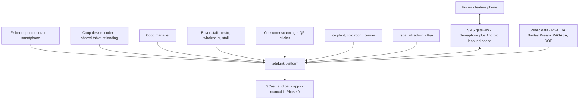
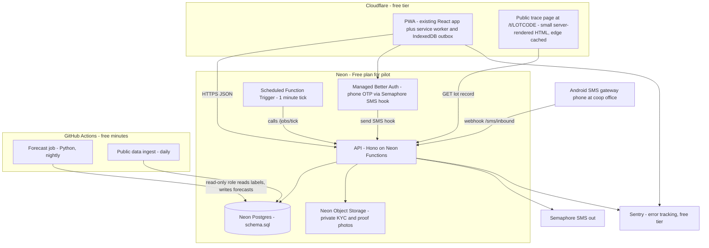
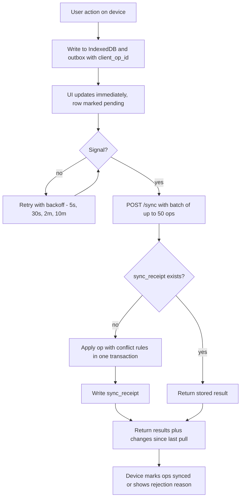

# IsdaLink — System architecture

Scope: the real system behind the demo at `/projects/islalink`. The demo UI stays. Its data functions (`getForecast`, `makeLot`, `verifyLot`, the arrays in `src/data/market.js`) get swapped one by one for API calls that **return the same shapes**, so the views keep working.

Words used below:
- **PWA (Progressive Web App)**: a website that installs like an app, works offline and can send push notifications. No app store needed.
- **Offline-first**: the app saves to the phone first and sends to the server when signal comes back.
- **Edge function**: a small piece of server code hosted for you, which starts on demand. You pay nothing when it is idle.
- **Cron**: a timer that runs a job on a schedule.

## 1. Decisions in one line each

| Area | Choice | Trade-off |
|---|---|---|
| Client | Evolve the existing Vite + React app into a PWA with an offline outbox | No native-app features like background Bluetooth logging until Phase 2. |
| Backend | One TypeScript API (Hono framework) on Neon Functions | Neon Functions keeps API, auth and data on one free pilot platform; Cloudflare remains only the static and cache layer. |
| Database | Neon Postgres, schema in `docs/schema.sql` | Free is ₱0 but scales to zero after 5 minutes and caps each project at 100 CU-hours and 1 GB storage. |
| Auth | Neon Managed Better Auth, with its SMS hook pointed at Semaphore | Login depends on SMS delivery, so the coop desk can also vouch for a member in person. |
| Object storage | Neon Object Storage for private KYC and proof photos | Free includes 5 GB per project; keep storage keys behind the API, never public URLs. |
| Static hosting | Cloudflare Pages for the PWA and the public QR trace page | Two vendors instead of one, but Cloudflare's free tier handles QR-page traffic spikes at ₱0. |
| ML | Nightly GitHub Actions job (Python) writes precomputed forecasts into Postgres | Forecasts are at most a day old, and there is no model server to run or pay for. |
| SMS out | Semaphore (Philippine SMS gateway) | Paid per message (around ₱0.50–₱1; confirm the current rate). Cheaper and better delivered on Globe/Smart than Twilio. |
| SMS in | An Android phone at the coop office running an SMS-gateway app that forwards texts to the API | A phone can be unplugged; we replace it with a Globe Labs or Semaphore inbound number at 10x. |
| USSD | Deferred | Needs a telco or aggregator contract; SMS keywords cover the pilot. |
| Payments | Phase 0: GCash/bank transfer to IsdaLink, manual payouts, every peso in the ledger | Manual work for Ryn, but there is no payment-gateway onboarding or money-handling licence question on day one. |

## 2. Context diagram

Who talks to the system.

## 3. Container diagram

The pieces we actually build and host.

## 4. Component responsibilities

**PWA (existing app, extended).**
- Buyer mode: browse listings, order, see order status, scan or open a lot.
- Fisher mode: my catch, my stock, prices, orders for my lots, payouts.
- **Desk mode** (new, the most important screen in Phase 0): a coop encoder on a shared tablet records catches, weighs lots, prints QR stickers on a Bluetooth thermal printer, logs ice and temperature, and enters the day's price survey. It must work fully offline.
- Holds an **outbox** in IndexedDB (the phone's built-in database). Every write is an operation with a `client_op_id`, retried until the server confirms.
- Caches read data per role: today's forecasts, own listings, open orders, species and site lists.

**API (Hono on Neon Functions).** One codebase with these modules:
- `sync`: accepts batches of offline operations and applies conflict rules (section 6).
- `market`: listings, orders, stock reservation in one transaction.
- `trace`: lot record and verify checks, in the same JSON shape as `makeLot()` and `verifyLot()`.
- `prices`: serves published forecasts in the same shape as `getForecast()`.
- `logistics`: providers, delivery requests, status updates.
- `money`: writes ledger journals, records payouts.
- `sms`: inbound keyword parser, outbound sender, OTP hook.
- `jobs`: `/jobs/tick` drains the `job` table.
- `admin`: KYC review, overrides, disputes.

Authorisation lives in the API: Neon Managed Better Auth proves identity, then the API checks `role_assignment` on every request. The browser receives no database credential, so access control does not depend on vendor-specific Row Level Security.

**Postgres.** Source of truth. Invariants are enforced in the schema (no overselling, append-only trace and ledger, balanced journals, lot/delivery time order), not only in API code, because offline sync and manual admin fixes both bypass the happy path.

**Forecast job.** Python on GitHub Actions, scheduled. Reads labels and signals, trains or backtests, writes `model_run` and `forecast` rows, applies guardrails before anything is published. Details in forecast-pipeline.md.

**Public trace page.** A Cloudflare Pages Function renders about 20 KB of plain HTML for `/t/ISL-2646-BAN-0142`. **Why not the full React app:** consumers scan on cheap phones with weak data; a page that loads in one round trip matters more than shared code. It is cached at the edge for 5 minutes, and for a day once the lot is closed.

## 5. Data flows per pillar

### Pillar 1 — Marketplace
1. Desk records the catch and its lots (offline is fine). On sync, each lot gets a `landed` trace event.
2. Fisher or desk creates a listing for a lot. Price defaults to the published p50 for that species and site; the fisher can change it. If the price is above p90, show "may not sell today".
3. Buyer places an order. The API does it in **one database transaction**: lock the listing row, check `qty_available_kg`, insert order and order lines, lower `qty_available_kg`, write the ledger journal (buyer receivable / coop payable / fee revenue). Two buyers clicking at once: one wins, the other gets "only 12 kg left".
4. A notification job texts the coop manager and fisher. Confirming is one tap or one SMS reply `OO 3312`.
5. Buyer pays by GCash or bank transfer and uploads the reference number. Ryn matches it and marks the order paid (manual in Phase 0).
6. After delivery is confirmed (or 24 hours with no dispute), the order is completed and the payout is queued.

**Orders cannot be placed or confirmed offline.** They reserve stock that other people are also buying, so only the server can decide. The buyer app shows "No signal — order not sent" instead of pretending.

### Pillar 2 — Price prediction
1. Every completed sale writes a `price_observation` (source `platform_sale`). The desk encoder also logs 3–5 trader prices every morning (`coop_desk_survey`), because platform sales alone are too few to train on.
2. The daily ingest job pulls diesel prices, PAGASA bulletins, and DA/PSA price series into `external_signal` and `price_observation`.
3. At 18:30 PHT the forecast job builds the label, runs the champion model per species, applies guardrails, and writes `forecast` rows as `published` or `suppressed`.
4. 18:30–19:15: the coop manager reviews tomorrow's numbers on one screen and can override them.
5. 19:30: price SMS to opted-in fishers; the app shows the same numbers.
6. The app reads `GET /prices/forecast?species=bangus&site=dagupan&days=7`. That returns the `getForecast()` shape: `forecast[].low/price/high` = p10/p50/p90; `confidence` = how often the band held in the last 60 days of backtest (an honest number, not the demo's formula).

### Pillar 3 — Catch and inventory
1. Catch records, lots, `loss` events and weigh-ins are all offline-capable appends.
2. Stock on hand = the `lot_stock` view. The Inventory screen's "spoilage risk" uses `landed_at`, `species.shelf_life_hours_on_ice` and the latest temperature reading. If there is no reading, risk is computed on time alone and labelled "no temperature data".
3. Job `lot.shelf_check` runs every 30 minutes: lots at 70% of shelf life with stock left trigger "sell or move to cold storage" (the demo's notification n1), once per lot, thanks to `dedupe_key`.

### Pillar 4 — Cold chain and delivery
1. A buyer picks delivery; the API creates a `delivery` row as `pending`.
2. **Phase 0 dispatch is manual**: Ryn or the coop manager phones or Viber-messages a courier from `service_provider`, then enters the courier and quoted fee. Status moves to `assigned`.
3. The courier (logged in as `provider_staff`, or the desk on their behalf) records pickup with a probe temperature and photo → `dispatched` trace event + `cold_chain_reading`.
4. At handover: probe temperature, re-weigh, photo, buyer taps "received" → `handed_over` trace event. Any weight gap or reading above 4°C opens a dispute automatically.
5. Ice and cold-room bookings in Phase 0 are a call log: the desk records `iced` and `cold_storage_in` events. There is no booking engine.

### Pillar 5 — QR traceability
1. The lot code is printed on a sticker at weighing time from the device's reserved number block, so it works offline.
2. QR content is just the URL `https://<domain>/t/ISL-2646-BAN-0142`. No data is in the QR, so the record can grow after printing.
3. The trace page reads the lot, its trace events, a cold-chain summary and verify checks. It returns the `makeLot()` shape: `events[]` with `at/label/place/actor/icon/tempC/note`, `coldChain {minC, maxC, breach, breachNote}`, `freshness`.
4. Verify checks are real now:
   - **Source registered**: approved KYC for the fisher, plus BoatR or pond permit on file.
   - **Landing logged**: a catch record with a desk-signed weight.
   - **Cold chain intact**: at least one reading at each custody change, none above 4°C. **If there are no readings, it says "Not monitored", never "OK"** (see risks-and-compliance.md).
   - **Record unaltered**: the hash chain checks out.
   - **QR matches lot**: the code exists and is not a child of a closed lot.
5. Each scan by a logged-in buyer appends a `buyer_scan` event. Anonymous scans are only counted in logs, to keep the timeline clean.

## 6. Offline-first sync model

Landing sites have patchy 3G/4G, especially before dawn. The desk tablet and fisher phones work on the device first and sync later.

**Conflict rules.** These are opinionated on purpose. Each one is a one-line rule an encoder can understand.

| What | Rule | Why |
|---|---|---|
| Catch record, lot, trace event, temperature reading, loss, price survey | **Append, never conflict.** Duplicates are dropped by `client_op_id` / `client_id`. | These are facts that happened. Two devices recording two facts are both right. |
| Lot weight or species typo | **Editable until the first sale or first sync plus 2 hours, whichever comes first.** After that, the fix is a `correction` event. | Fixing a typo should be easy; changing history after money moved should be visible. |
| Listing price or quantity | **Server wins if an order exists against the listing;** otherwise last write wins, by server time. | A buyer who already paid ₱205 must not see ₱230 appear. |
| Order create or confirm | **Online only.** | Stock reservation must be decided by one place. |
| Delivery status | **Forward-only:** a sync can move status forward (assigned → picked up → delivered), never back. | Late syncs from a courier's phone must not undo a delivery. |
| Person or profile edits | Last write wins, by server time. | Low stakes. |
| Revoked device | Every push is rejected; the reason shows on the device. | Lost tablets. |

**Clocks.** Every op carries the device time; the server also records its own time. If the device clock is more than 10 minutes off, the op is accepted but flagged, and the UI asks the encoder to fix the tablet clock. Event display order uses device time; integrity uses server sequence.

**Lot numbers offline.** Each desk device keeps one spare block of 50 lot numbers per pilot species for the current and next ISO week, topped up on every sync. A busy Dagupan morning is well under 50 bangus lots per tablet.

**What syncs down.** Per role, only what that person needs: the desk gets its site's open lots, today's forecasts and member list; a buyer gets open listings and their own orders. The cap is about 2 MB, so first sync works on slow data.

## 7. Feature-phone channel (SMS)

USSD is deferred. In Phase 0 a fisher with a basic phone uses **SMS keywords in Filipino**, sent to the coop's gateway number. One-word commands, forgiving parser (any case, extra spaces, missing order number when there is only one open order).

| Fisher texts | System replies |
|---|---|
| `PRESYO` or `PRESYO BANGUS` | `ISDALINK Bangus Dagupan bukas P180-P195/kg. Payo: IBENTA NA. Hindi garantiya ang presyo.` |
| `BENTA 120 BANGUS 205` | Creates a **draft** listing; the desk confirms the weight when the fish is weighed. Reply has a draft number. |
| `OO 3312` / `HINDI 3312` | Accept or decline order ORD-3312. |
| `BAYAD` | Last 3 payouts with GCash reference numbers. |
| `TULONG` | Calls back the coop desk (creates a task for the manager). |
| `STOP` | Ends price SMS (withdraws `price_sms` consent). |

Outbound SMS is kept under 160 characters (one billable message), with no emoji (emoji switches the SMS encoding and halves the length). Pesos are written `P` in SMS because `₱` also forces that encoding. In-app pesos stay `₱`.

## 8. Notifications

One `notification` table, three channels, chosen in this order: in-app if the person opened the app in the last 24 hours, then web push if allowed, then SMS if consented. Feature-phone-only users always get SMS. Urgent kinds (`typhoon.alert`, `order.new` for a fisher, `lot.shelf_warning`) skip quiet hours. Each kind has a `dedupe_key` pattern so the same lot never gets two shelf warnings.

## 9. Background jobs

A scheduled Neon Function Trigger calls `/jobs/tick` every minute; Neon documents that scheduled Function Triggers still fire when database compute has scaled to zero, unlike `pg_cron`. The tick claims ready rows from `job` with a 5-minute lease, so a crashed run gets retried. After 5 failures a job is marked `dead` and Ryn gets an email.

| Job | When | What |
|---|---|---|
| `notify.send` | on enqueue | Send one notification. |
| `listing.expire` | every 15 min | Close listings past `expires_at`. |
| `lot.shelf_check` | every 30 min | Shelf-life warnings. |
| `offer.expire` | every 15 min | Expire bids (Phase 1). |
| `order.autocomplete` | hourly | Delivered + 24 h + no dispute → completed, queue payout. |
| `signals.ingest` | GitHub Actions, daily 06:00 PHT | Diesel, PAGASA, holidays, public prices. |
| `forecast.nightly` | GitHub Actions, 18:30 PHT | Build labels, forecast, guardrails, publish. |
| `forecast.sms` | 19:30 PHT | Price SMS to opted-in fishers. |
| `model.retrain` | GitHub Actions, Sunday 22:00 PHT | Retrain and backtest the challengers. |
| `ledger.reconcile` | daily 23:00 PHT | Every journal balances; payouts match payables; mismatches email Ryn. |
| `trace.chain_audit` | daily | Recompute hash chains for lots touched in the last 7 days. |

A free uptime check (healthchecks.io) watches that `forecast.nightly` and the tick actually ran.

## 10. Hosting and cost

| Item | Plan | Monthly |
|---|---|---|
| Neon Postgres + Functions + Managed Better Auth + Object Storage | Free for the pilot | ₱0; move to Launch at about ₱850 ($15) when Postgres storage exceeds 1 GB or compute exceeds 100 CU-hours in a month |
| Cloudflare Pages + Functions | Free | ₱0 |
| GitHub Actions | Free minutes (about 15 min/day used) | ₱0 |
| Sentry | Free developer tier | ₱0 |
| Domain | — | about ₱60 |
| Semaphore SMS | Pay per message | about ₱1,500–₱3,000 at pilot volume |
| Android gateway phone + prepaid load | One-time phone, then load | about ₱300 |

Expected tech cost at pilot: **about ₱1,900–₱3,400 a month**, driven by SMS; Neon is ₱0 on Free. If either database limit is crossed, Launch adds roughly ₱850/month at small intermittent usage.

**Why not a single VPS (one rented server)?** It is cheaper on paper, but Ryn would become the database admin, backup operator and security patcher. Neon Free keeps the pilot managed at ₱0 while the plain-Postgres schema preserves an exit path.

## 11. What breaks first at 10x

Ten times the pilot is roughly 10 coops, 1,500 fishers, 300 buyers, 5 ports.

1. **People, not servers.** Manual courier dispatch, manual GCash payouts, KYC review and payment matching scale with Ryn's hours. At about 30 orders a day this is a full-time job. Fixes, in order: a payment gateway with automatic matching (PayMongo or Xendit), batch payouts, then courier self-assignment.
2. **SMS cost.** Daily price SMS to 1,500 fishers is about 45,000 messages a month. Fix: weekly SMS by default, daily for opted-in active sellers, and move app users to free push.
3. **The Android inbound phone.** One phone per coop office does not scale. Fix: one inbound number (Globe Labs or an aggregator) with keyword routing by sender's coop.
4. **Forecast label sparsity, not compute.** New ports have no history. The pipeline's cold-start rules (range-only, pooled models) handle it; compute stays cheap because forecasts are precomputed.
5. **QR page spikes** if a supermarket prints QR codes on consumer packs. It is already edge-cached, so this mostly just works.
6. **Postgres size** stays small: about 1 GB a year even with Bluetooth loggers. The first real database pressure will be `cold_chain_reading`. Partition it by month when it passes 10 million rows.

Nothing in the stack needs replacing at 10x. The ops work does.

## 12. Plugging into the demo

| Demo function or data | Real source | Shape change |
|---|---|---|
| `getForecast(speciesId, {days, today})` | `GET /prices/forecast?species&site&days` | Adds a required **site**. `days` capped at 7. `confidence` redefined as band hit rate. |
| `getMarketSummary`, `getDemandHeat` | `GET /prices/summary?site`, `GET /prices/demand-heat?site` | Demand heat comes from platform order counts per weekday, shown only after 8 weeks of orders. |
| `makeLot`, `makeLots` | `GET /trace/:lotCode`, `GET /lots?site` | Same fields. `freshness.grade` is null when there are no temperature readings. |
| `verifyLot(lotId)` | `GET /trace/:lotCode/verify` | Same `checks[]` shape. "No price tampering" becomes "Record unaltered". `ok` can also be `null`, meaning "not monitored". |
| `LISTINGS`, `MY_CATCH`, `INCOMING_ORDERS` | `/listings`, `/me/stock`, `/me/orders` | Same fields. `verified` is derived from KYC, not stored. |
| `ICE_SUPPLIERS`, `COLD_STORES`, `COURIERS` | `/providers?site&kind` | `eta`, `blocksAvailable`, `freeKg` become "call to confirm" in Phase 0. |
| `FISHER_STATS` | `/me/stats` | Computed from the ledger and loss events. |

The Developer does this swap behind a thin `src/lib/api.js` adapter, one view at a time. The demo stays working throughout.
